<div align="center">

<picture>
  <source media="(prefers-color-scheme: dark)" srcset="docs/img/logo-horizontal-dark.png">
  
</picture>

### O cliente SVN de desktop que trata o Subversion como ele é — com a cara de uma IDE moderna

Fluxo no espírito do TortoiseSVN, design repaginado e os projetos e o servidor da equipe já pré-configurados.

<p>
  
  
  
  
  
  
  
  
</p>

[Recursos](#-recursos) ·
[Telas](#-tour-pelas-telas) ·
[Instalação](#-instalação) ·
[Desenvolvimento](#-desenvolvimento) ·
[Arquitetura](#-arquitetura) ·
[Configuração](#%EF%B8%8F-configuração) ·
[Atalhos](#%EF%B8%8F-atalhos) ·
[Problemas comuns](#-solução-de-problemas)

<br>

<picture>
  <source media="(prefers-color-scheme: light)" srcset="docs/img/screens/overview-light.png">
  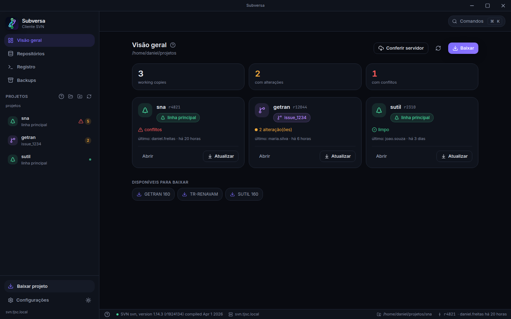
</picture>

</div>

---

## ✨ O que é

**Subversa** é um aplicativo de desktop para **Linux** que cobre todo o ciclo de trabalho em Subversion sem decorar comandos: detectar working copies, revisar e commitar alterações, criar e trocar branches, receber a linha principal, publicar (reintegrar), navegar pelo repositório, ler o histórico em lista ou em grafo e resolver conflitos num editor de três painéis.

Ele nasceu do `GUIA_SVN.md` e do `fluxo_svn.sh` da equipe e segue as mesmas regras: a mesma sequência de passos, a mesma convenção de branch (`ISSUES <ano>/<NN - MÊS>/…`), a mesma autenticação (`svn+ssh` com `sshpass` + ControlMaster) e os mesmos projetos prontos (sna, getran, getran160, trrenavam, sutil, sutil160).

> [!NOTE]
> **Por que não Git?** O versionamento da equipe é SVN, e o Subversa abraça o modelo do SVN de verdade: **não existe `push`** (o `svn commit` já vai para o servidor), uma branch é uma **cópia de diretório** e trocar de branch é `svn switch`.

---

## 🚀 Recursos

<table>
<tr>
<td width="50%" valign="top">

### 🗂️ Working copies
- **Detecção automática** na pasta de trabalho, com indicador de *trunk* (verde) × *branch* (roxo) e contagem de alterações.
- **Baixar projeto** a partir dos presets ou de uma URL, com progresso ao vivo arquivo a arquivo.
- Painel de **atividade global** para checkout, update, switch, merge e export — todos **canceláveis**.

### ✅ Alterações e commit
- Lista com checkboxes no estilo TortoiseSVN, pastas diferenciadas por ícone.
- Diff **unificado ou lado a lado**, com realce **palavra a palavra**, opções de espaço em branco e expansão de contexto.
- **Reverter um trecho** só (faixa `»` entre os painéis, estilo IntelliJ), reverter arquivo ou tudo — com **Ctrl+Z**.
- Adicionar/excluir arquivos novos, **svn:ignore com um clique** (arquivo ou extensão).
- **Aviso forte ao commitar direto no trunk.**

### 📝 Editores embutidos
- **Editor de código** (CodeMirror) com abas, busca/substituição no estilo IntelliJ, ir para arquivo/linha e **reformatar por linguagem** (Prettier: Java, XML, SQL e outras).
- **Editor de conflitos em 3 painéis** (meu · resultado · servidor), cores por tipo de mudança, desfazer/refazer e atalhos de teclado.
- Preserva a **codificação original** (UTF-8 ou ISO-8859-1): nada de mojibake nem diffs gigantes.

</td>
<td width="50%" valign="top">

### 🕓 Histórico e grafo
- **Histórico** com busca em todo o log, autoria por avatar, datas relativas, arquivos por revisão e diff da revisão.
- **Gráfico** em "mapa de metrô": trunk e branches como linhas, setas de *sync* e *reintegração*, modo foco por linha.
- Aba **Entrada**: o que vai chegar no próximo update, antes de atualizar.
- **Blame** (autoria por linha) no navegador, nas Alterações e no Histórico.

### 🌿 Branches e integração
- Criação seguindo a convenção `ISSUES …` (com *switch* opcional), troca de linha e exclusão protegida.
- **Integração guiada**: *sync* (trunk → branch) e *publicar/reintegrar* (branch → trunk) com pré-visualização (*dry-run*).
- Funciona em **servidor SVN antigo, sem mergeinfo** (cai para merge clássico automaticamente).

### 🛟 Rede de segurança
- **Ponto de restauração** (backup) antes de operações destrutivas, com restauração em um clique.
- **Guardar para depois**: shelves nomeados e persistentes, como o `stash` do Git.
- **Registro** de cada comando `svn` executado (com duração e código de saída).
- Paleta de comandos (`Ctrl/⌘ + K`), tema escuro e claro, 100% offline.

</td>
</tr>
</table>

---

## 📸 Tour pelas telas

> As imagens abaixo são geradas automaticamente a partir dos **dados fictícios** do mock de testes (`npm run docs:screenshots`) — nenhum dado do servidor real.

### Alterações e commit

Revise cada arquivo, escolha o que entra no commit e reverta só o trecho que não deveria ir.

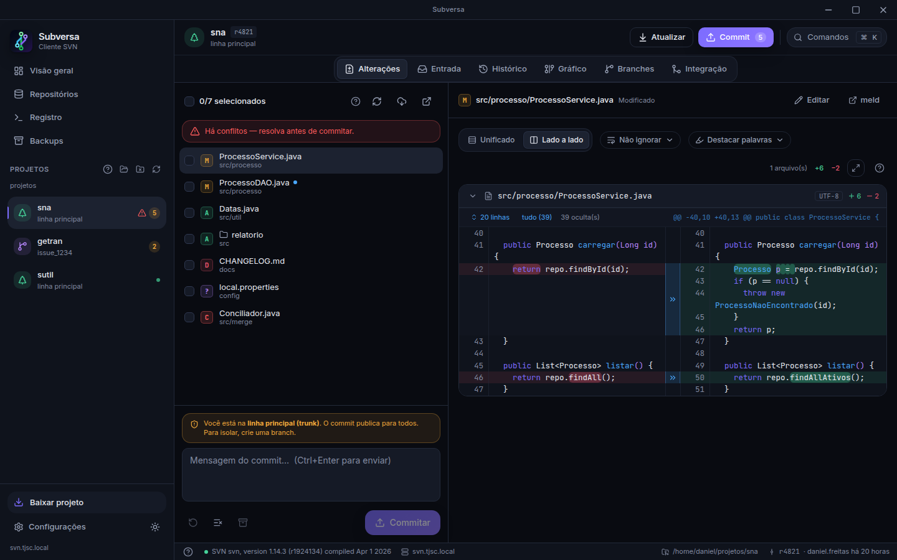

<details>
<summary><b>Mesma tela no tema claro</b></summary>

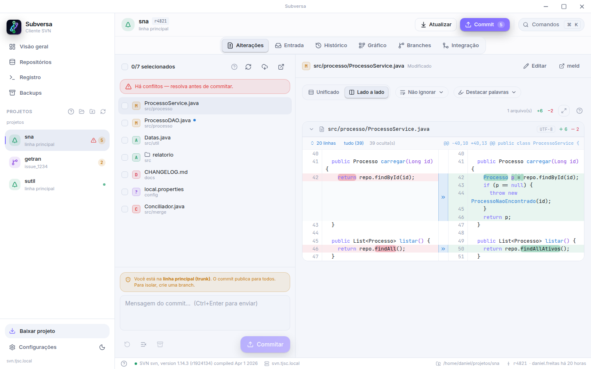

</details>

### Histórico, grafo e entrada

| Histórico | Gráfico do projeto |
|---|---|
| 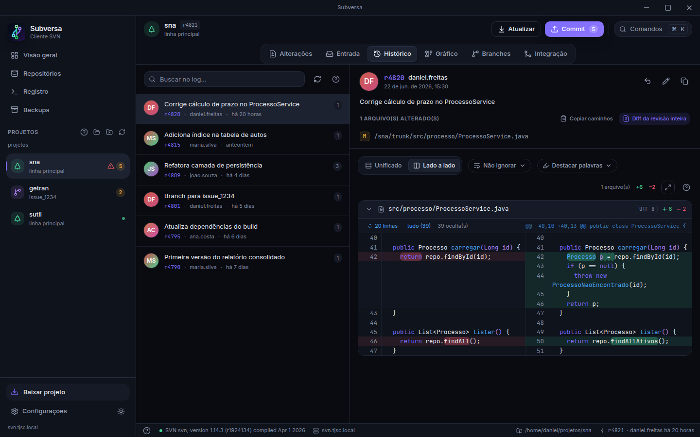 | 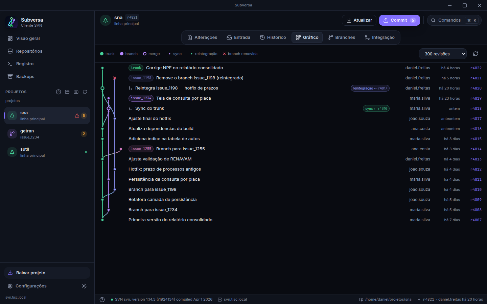 |
| **Entrada (a receber)** | **Registro de comandos** |
| 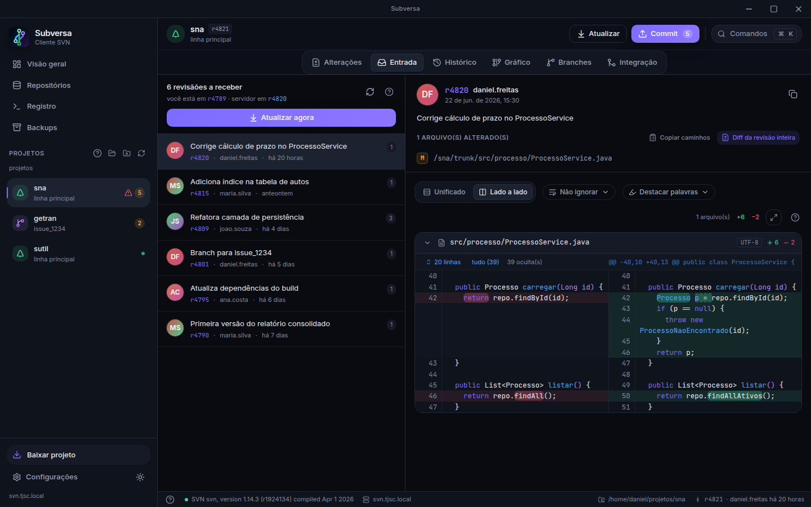 | 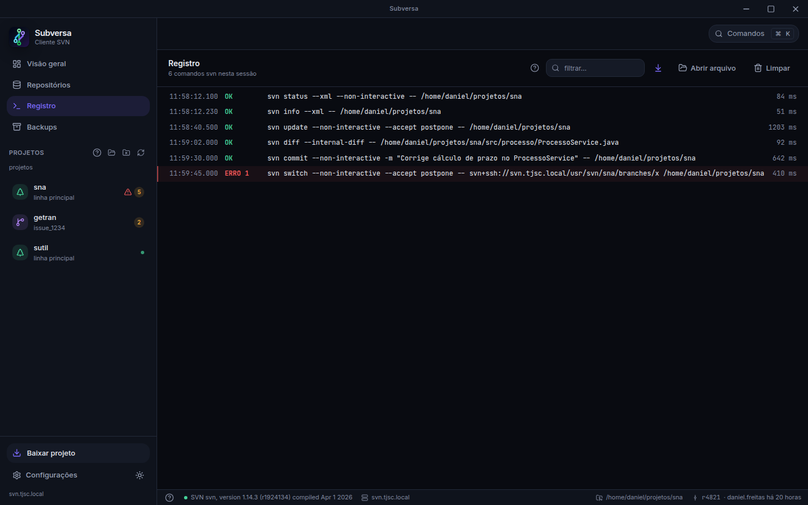 |

### Branches e integração

| Branches | Integração (sync / reintegrar) |
|---|---|
| 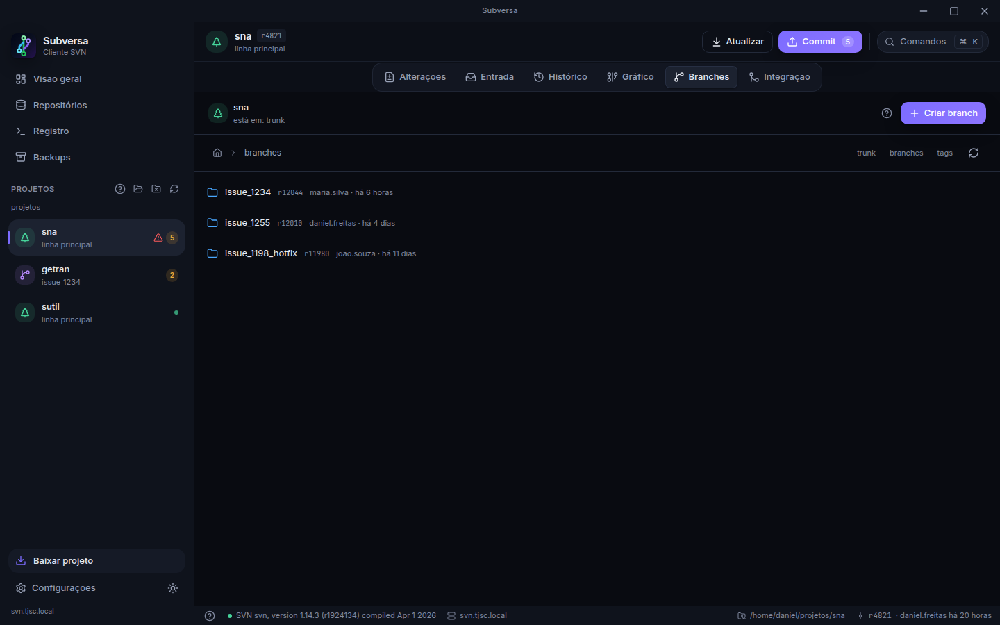 | 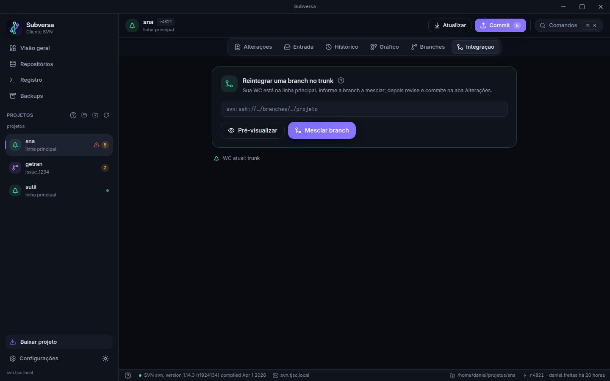 |

### Editores

| Conflitos em 3 painéis | Editor de código |
|---|---|
| 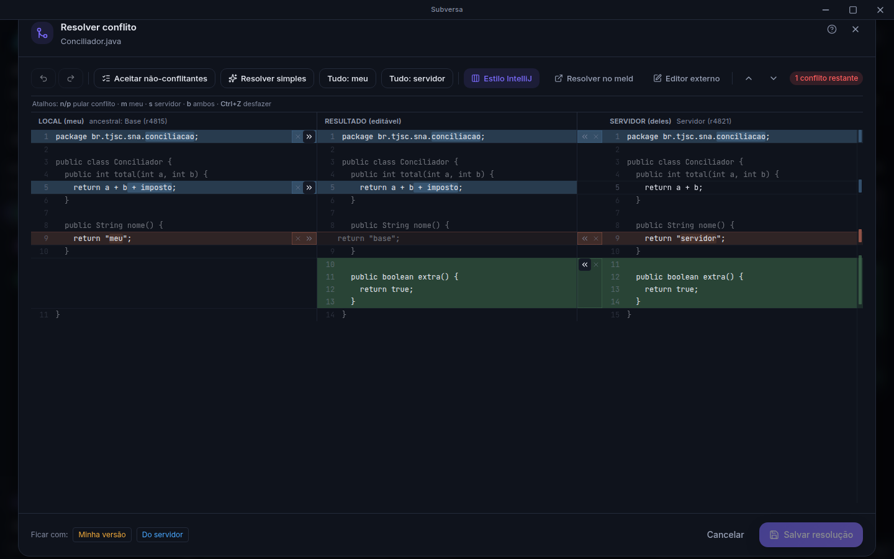 | 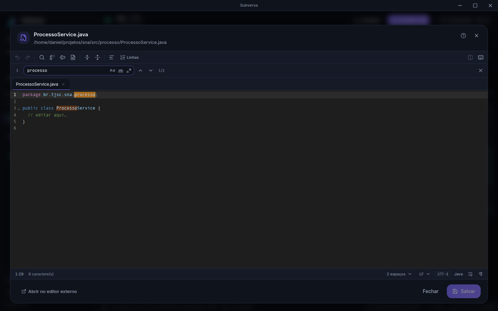 |

### Repositórios, backups, paleta e configurações

| Navegador de repositórios | Pontos de restauração |
|---|---|
| 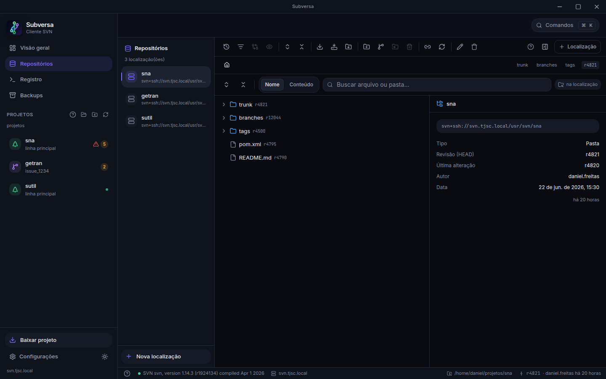 | 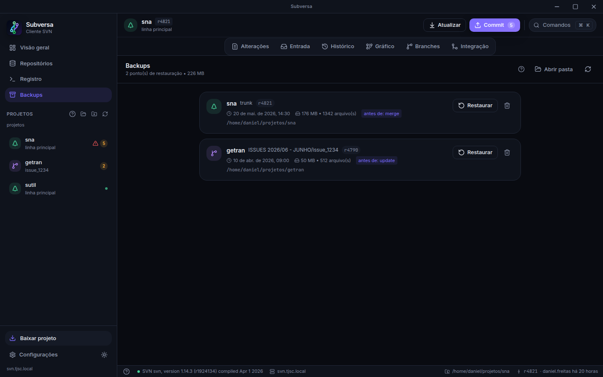 |
| **Paleta de comandos** | **Configurações** |
| 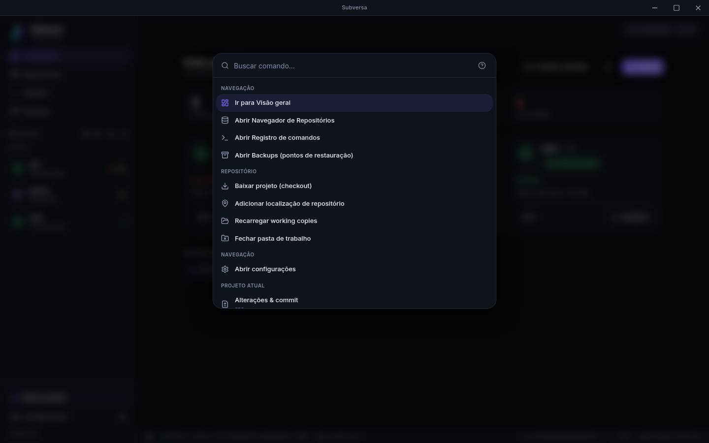 | 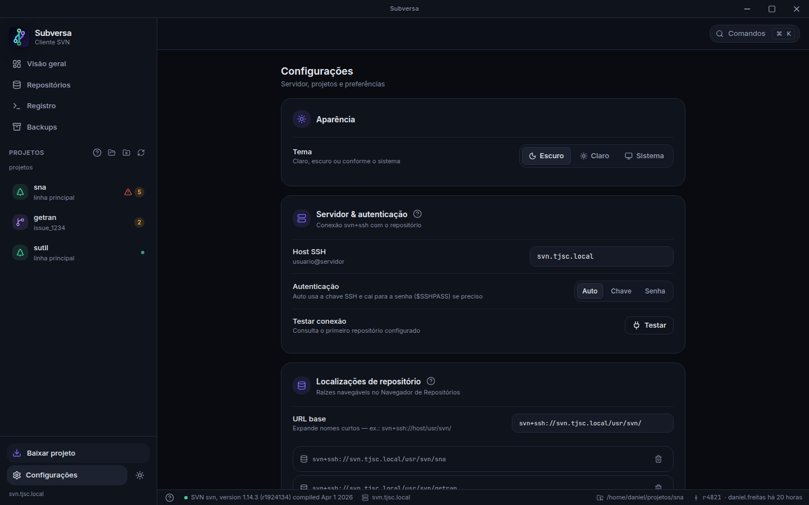 |

---

## 🔁 Do Git para o SVN (e para o Subversa)

| No Git você faz… | No SVN é… | No Subversa |
|---|---|---|
| `git clone` | `svn checkout` | **Baixar projeto** (preset ou URL) |
| `git pull` | `svn update` | Botão **Atualizar** |
| `git stash` | — (não existe) | **Guardar para depois** |
| criar branch | `svn copy` + `svn switch` | **Criar branch** (convenção `ISSUES …` automática) |
| `add` + `commit` + `push` | `svn commit` | Aba **Alterações** (um passo só) |
| trazer a main para a branch | `svn merge <trunk>` + commit | Integração → **Receber e commitar** |
| merge da branch na main | `switch` + `update` + `merge` + commit | Integração → **Publicar branch no trunk** |
| apagar branch | `svn delete <url>` | Branches → **apagar** (digitando o nome) |

O ciclo de vida de uma tarefa fica assim:

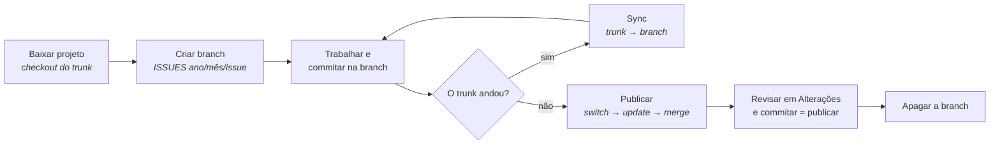

> [!IMPORTANT]
> Na publicação o Subversa **não commita sozinho**: ele faz o merge e te leva para a aba Alterações. O commit é a publicação — você revisa antes.

---

## 📦 Instalação

### Requisitos de uso

| Requisito | Para quê |
|---|---|
| `svn` 1.8+ (testado com 1.14) | todas as operações |
| `openssh-client` | transporte `svn+ssh` |
| `sshpass` *(opcional)* | autenticar por senha via `$SSHPASS` |

O pacote `.deb` já declara essas dependências, então o `apt` as instala junto:

```bash
sudo apt install ./Subversa_1.0.0_amd64.deb
```

A senha vem de `$SSHPASS` (por exemplo, em `/etc/environment`) **ou** de uma chave SSH/`ssh-agent` configurada no servidor. Na primeira execução uma tela de configuração pede o host SSH.

> [!NOTE]
> Distribuição manual: não há auto-updater nem assinatura de binário. Atualizar = gerar e distribuir um novo pacote.

---

## 🛠️ Desenvolvimento

São duas categorias de dependência: **toolchains** (Node + Rust), geridas pelo [mise](https://mise.jdx.dev), e **bibliotecas de sistema** do Tauri, que vêm do `apt`.

```bash
# 1. Bibliotecas de sistema + runtime (Ubuntu/Debian)
sudo apt install -y libwebkit2gtk-4.1-dev libsoup-3.0-dev build-essential \
  libssl-dev libgtk-3-dev librsvg2-dev libayatana-appindicator3-dev \
  subversion sshpass

# 2. Toolchains fixadas no mise.toml (Node 20.20.2 + Rust 1.96.0, com clippy e rustfmt)
mise trust && mise install

# 3. Dependências e app em modo dev (Vite com HMR + backend Rust em debug)
npm install
npm run tauri dev
```

> [!TIP]
> Sem mise, instale Node 20+ (nvm) e Rust stable ≥ 1.77 (rustup). Com mise, há atalhos: `mise run dev`, `mise run build` e `mise run check`.
>
> Janela em branco no X11? Rode com `WEBKIT_DISABLE_DMABUF_RENDERER=1 WEBKIT_DISABLE_COMPOSITING_MODE=1 npm run tauri dev`.

### Scripts

| Comando | O que faz |
|---|---|
| `npm run tauri dev` | app completo em desenvolvimento |
| `npm run dev` | só o frontend (Vite em `:1420`, sem backend nativo) |
| `npm run check` | typecheck + build + Vitest + `cargo fmt` + `clippy -D warnings` + `cargo test` |
| `npm run test:unit` | testes unitários do frontend (Vitest) |
| `npm run e2e` | testes visuais com Playwright e IPC do Tauri mockado |
| `npm run e2e:update` | regenera os screenshots-baseline do e2e |
| `npm run docs:screenshots` | regenera as imagens deste README |
| `npm run tauri build` | binário de produção + pacotes (`.deb`, AppImage) |
| `npm run tauri build -- --bundles deb` | só o `.deb` |

Os artefatos saem em `src-tauri/target/release/` (binário `subversa`) e `src-tauri/target/release/bundle/`.

### Qualidade

- **Frontend:** TypeScript estrito (variáveis e parâmetros sem uso quebram o build) e Vitest para a lógica pura (parser de diff, diff3, grafo, busca do editor, indentação…).
- **Backend:** `cargo fmt --check`, `cargo clippy -D warnings` e `cargo test` (parser XML, reconstrução de hunks, validação de URL/caminho, codificação, cancelamento).
- **E2E:** Playwright no Chrome do sistema dirigindo o frontend real com o IPC do Tauri **mockado** (`e2e/mock/tauri.ts`) — asserts de conteúdo + regressão visual por screenshot.
- **CI** (GitHub Actions): tudo acima + geração do `.deb`.

---

## 🧭 Arquitetura

O frontend **nunca executa o `svn`**. Ele chama comandos Tauri via `invoke()`; o backend Rust monta os argumentos, injeta a autenticação SSH, executa o `svn`, interpreta a saída `--xml` e devolve dados tipados.

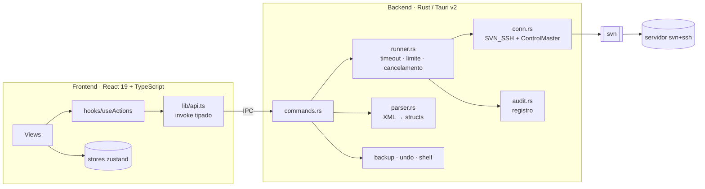

Princípios que guiam o código:

- **Saída `--xml` e códigos de erro, nunca texto traduzido.** O `svn` continua em português; a robustez vem do XML (independente de idioma) e de códigos como `E155011`, `E160013`, `E200007`, mapeados para dicas amigáveis.
- **Operações longas transmitem progresso e podem ser canceladas**; todo comando é registrado e tem limite de tempo e de tamanho de saída.
- **Tema por variáveis CSS** em tempo de execução (Tailwind v4 `@theme`), com as cores de status do `fluxo_svn.sh`: M âmbar, A verde, D vermelho, ? roxo, C vermelho forte.

| Camada | Stack |
|---|---|
| Desktop / backend | Tauri v2, Rust, Tokio, quick-xml + serde |
| Frontend | React 19, TypeScript, Vite 7, Tailwind CSS v4 |
| Estado e UI | Zustand, Framer Motion, Lucide |
| Editores | CodeMirror 6, Prettier (Java, XML, SQL…), jsdiff |
| Testes | Vitest, Playwright, `cargo test` |

Detalhes em **[docs/ARQUITETURA.md](docs/ARQUITETURA.md)**.

<details>
<summary><b>Estrutura de pastas</b></summary>

```text
src/                 frontend React
  views/             uma tela por aba (Alterações, Histórico, Gráfico, …)
  components/        ui, layout, diff, editor, merge, history, repos, dialogs…
  hooks/             ações de alto nível (confirmação + toast + refresh)
  store/             estado global (zustand)
  lib/               api tipada, tipos e motores puros com testes
src-tauri/src/
  svn/               comandos, runner, parser, conexão, backup, undo, shelf…
  config.rs          leitura/gravação atômica da configuração
e2e/                 testes Playwright + mock do IPC + roteiro das imagens do README
docs/                arquitetura, imagens e base de aprendizado (docs/learning)
```

</details>

---

## ⚙️ Configuração

Na primeira execução é criado `~/.config/subversa/config.json`. Tudo é editável na aba **Configurações**:

| Opção | Descrição |
|---|---|
| Pasta de trabalho | onde ficam as working copies (detecção automática) |
| Host SSH e URL base | servidor `svn+ssh` e raízes de repositório conhecidas |
| Modo de autenticação | `auto`, `chave` ou `senha` |
| Meus projetos | atalhos de checkout e URL da linha principal (usada no sync/reintegração e para reconhecer trunk × branch) |
| Backups | perguntar, sempre ou nunca; quantos manter por working copy |
| Preferências | confirmar operações no servidor, modo verboso (mostra o comando `svn`), ferramenta de diff externa (`meld`), editor externo, tema |

### Autenticação `svn+ssh`

Reproduz a estratégia do `fluxo_svn.sh`: a variável `SVN_SSH` usa `sshpass -e ssh …` (lendo `$SSHPASS`) quando há senha, ou `ssh` puro com chave; e um **ControlMaster** persistente (`~/.cache/subversa/ssh/`) evita pedir a senha a cada comando. A conexão mestre é encerrada quando a janela fecha.

### Onde o app guarda coisas

| Caminho | Conteúdo |
|---|---|
| `~/.config/subversa/config.json` | configuração |
| `~/.local/share/subversa/shelves` | itens de "guardar para depois" |
| `~/.cache/subversa/backups` | pontos de restauração (padrão) |
| `~/.cache/subversa/ssh/` | socket do ControlMaster |
| `~/.cache/subversa/crash.log` | log em caso de crash |

---

## ⌨️ Atalhos

<table>
<tr>
<td valign="top">

**Gerais**

| Atalho | Ação |
|---|---|
| `Ctrl/⌘ + K` | paleta de comandos |
| `Ctrl/⌘ + Enter` | commitar (no campo de mensagem) |
| `Ctrl/⌘ + Z` | desfazer o último revert |
| `Esc` | fechar diálogos e paleta |
| `F5` | recarregar o navegador de repositórios |
| `Ctrl + Alt + Insert` | copiar a URL do item no navegador |

**Editor de conflitos**

| Atalho | Ação |
|---|---|
| `n` / `p` | próximo / anterior conflito |
| `m` / `s` / `b` | ficar com o meu / do servidor / ambos |

</td>
<td valign="top">

**Editor de código**

| Atalho | Ação |
|---|---|
| `Ctrl + S` | salvar |
| `Ctrl + F` / `Ctrl + R` | localizar / substituir |
| `F3` / `Shift + F3` | próximo / anterior resultado |
| `Ctrl + G` | ir para linha |
| `Ctrl + Shift + N` | ir para arquivo |
| `Ctrl + Alt + L` | reformatar o arquivo |
| `Ctrl + D` / `Ctrl + Y` | duplicar / apagar linha |
| `Ctrl + /` | comentar linha |
| `Alt + ←/→` | trocar de aba |

</td>
</tr>
</table>

---

## 🔒 Segurança e cuidados

- Operações que **escrevem no servidor** (commit, merge, switch, copy, delete) pedem confirmação (configurável).
- Commitar **direto no trunk** mostra um aviso destacado; apagar branch no servidor exige **digitar o nome**.
- O backend só aceita operações remotas nas localizações cadastradas (`repoRoots`) ou nas URLs dos projetos configurados.
- Checkouts e exports só gravam em caminhos absolutos dentro da pasta de trabalho; imports exigem uma pasta local existente.
- Saídas grandes do `svn` são limitadas para proteger a interface: 20 MiB para diff/log/status/list/info, 5 MiB para prévia de arquivo e 10 MiB para blame.
- Nomes com `@` são escapados corretamente (sem confusão com revisão-peg do SVN).

---

## 🩺 Solução de problemas

| Sintoma | O que fazer |
|---|---|
| "Falha de conexão / rede fechou" | verifique VPN/rede e o acesso SSH ao servidor |
| Pede senha o tempo todo | garanta `$SSHPASS` no ambiente ou uma chave SSH; instale o `sshpass` |
| `E155004` (locked) | **Limpar / destravar (cleanup)** na paleta de comandos |
| `E155011` / `E160024` (desatualizado) | **Atualizar** antes de commitar |
| Conflito (`C`) | aba **Alterações** → **Resolver conflito** |
| `E200007` (sem mergeinfo) | nada: o app cai para o merge clássico sozinho; o Gráfico fica sem as setas de merge |
| `meld` não abre no AppImage | já tratado: o app limpa o ambiente do AppImage antes de abrir programas externos |
| Janela em branco no Linux | rode com `WEBKIT_DISABLE_DMABUF_RENDERER=1` |

---

## 🤝 Contribuindo

- Código, interface, comentários e mensagens em **português do Brasil**.
- Commits no padrão **Conventional Commits** com tipo em inglês e assunto em pt-BR no presente: `fix(merge): aceita working copy de revisão mista`.
- Antes de abrir PR: `npm run check` e `npm run e2e`. Um comando novo no backend precisa de stub em `e2e/mock/tauri.ts`.
- Mudou uma tela que aparece aqui? Rode `npm run docs:screenshots`.
- Instruções para agentes de IA em [`AGENTS.md`](AGENTS.md); aprendizados do projeto em [`LEARNING.md`](LEARNING.md).

## 📄 Licença

Projeto interno e proprietário (`UNLICENSED`), feito sob medida para o fluxo da equipe. Sem licença pública de distribuição.

<div align="center">
<br>

<br>
<sub>Subversa · cliente SVN moderno · Tauri + React</sub>
</div>
